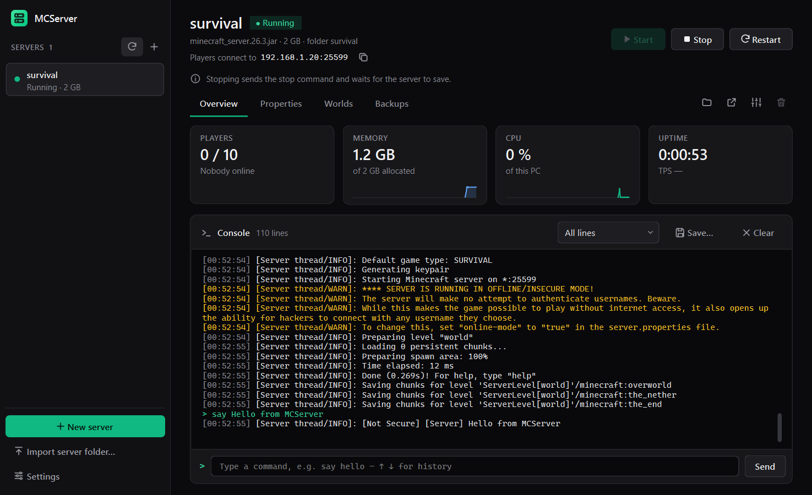
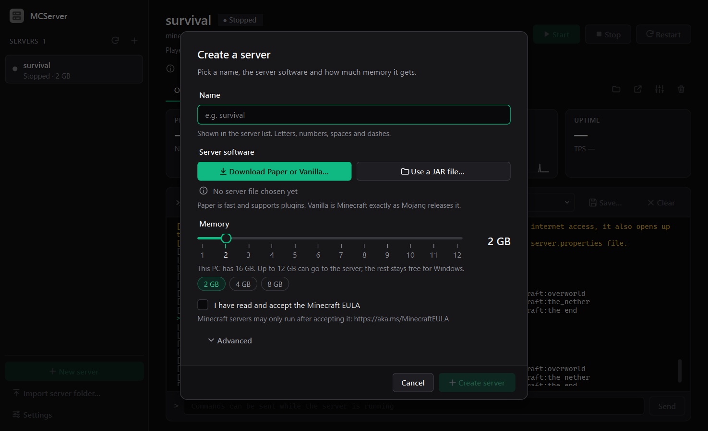

# MCServer

**A simple, modern way to host and manage Minecraft servers.**

MCServer is a Windows desktop app for running Minecraft Java servers on your own PC — no command
line, no batch files. Create a server in a minute, start it with one click, and keep an eye on
players, performance and the console in one window.

## Features

- **Create in a minute** — download Paper or Vanilla, or use your own server JAR; memory is sized for your PC.
- **Import what you have** — bring in an existing server folder; the original is never changed.
- **Run it safely** — start, stop and restart with proper saving, and automatic restart after a crash.
- **See what's happening** — live console with command history, plus players, memory, CPU and uptime.
- **Configure without a text editor** — `server.properties` with readable names, grouped and searchable.
- **Worlds and backups** — create, import and switch worlds; one-click and scheduled backups with safe restore.
- **Feels at home** — English and Ukrainian, light and dark theme that follows Windows.

## Requirements

- Windows 10 or 11 (64-bit)
- Java — not included; MCServer finds the Java on your PC. Minecraft 1.20.5 and newer need Java 21 or newer
  ([Eclipse Temurin](https://adoptium.net) works well).

## Get started

Download the installer from [Releases](https://github.com/theloomik/MCServer/releases), run it, and
open MCServer from the Start menu. No administrator rights needed. The
**[User guide](docs/user-guide.md)** walks through everything else.

## Links

- [User guide](docs/user-guide.md) — install, create, run, back up, troubleshoot
- [What's new](CHANGELOG.md) — changes in each release
- [Building from source](docs/building.md) — development setup, tests, app and installer builds
- [Translations](docs/translations.md) — help translate MCServer
- [Report a bug or suggest a feature](https://github.com/theloomik/MCServer/issues/new/choose)
- [Contributing](CONTRIBUTING.md) · [Security](SECURITY.md) · [MIT License](LICENSE)
