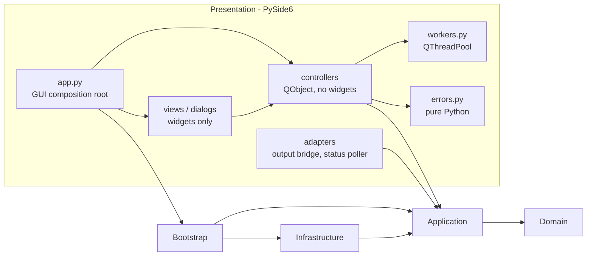
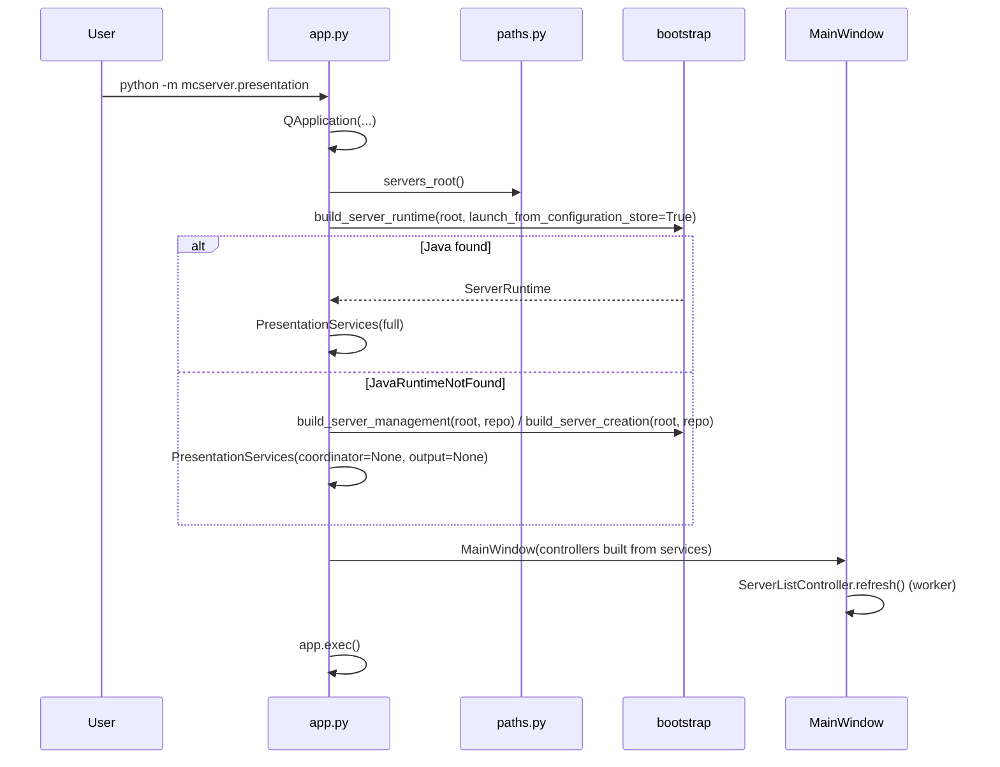
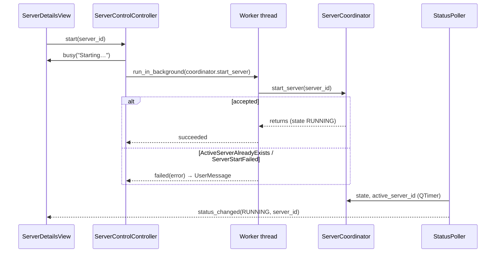
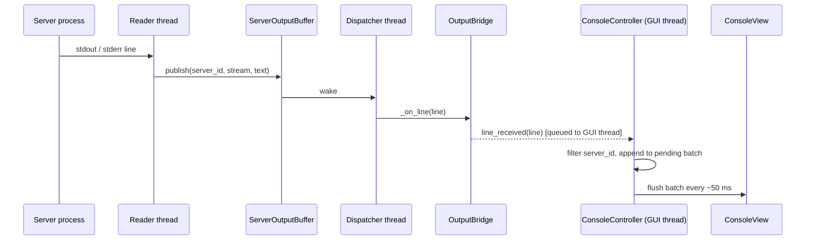

# MCServer 2.0 GUI Architecture (Proposal)

**Status:** Proposal — awaiting review before implementation.
**Scope:** PySide6 presentation layer on top of the merged backend (`origin/dev` at `e47eaed`). No backend changes are proposed as part of the MVP; backend follow-ups are listed separately.

---

## 1. Current backend assessment

### 1.1 What the GUI can reuse directly

Verified against the source code:

| Need | Existing API | Notes |
|---|---|---|
| Build everything once | `build_server_runtime(servers_directory, java_resolver=None, output_capacity=2000, *, launch_from_configuration_store=False) -> ServerRuntime` | `servers_directory` is **required**. The GUI must pass `launch_from_configuration_store=True`, otherwise servers created through the new store cannot be started. |
| Shut down | `ServerRuntime.close(timeout=10.0) -> bool`, context manager | Stops the active server (blocking up to ~2×`timeout`), then ends output delivery. |
| List / read servers | `runtime.management.list_servers() -> tuple[ServerConfiguration, ...]`, `get_server(server_id)` | `ServerConfiguration(server_id, directory, jar_file, memory_mb)`. |
| Edit / delete | `management.update_server(server_id, *, directory=None, jar_file=None, memory_mb=None)`, `delete_server(server_id)` | Delete removes only the record; files stay on disk. Changes take effect on the next launch. |
| Legacy import | `management.import_legacy_servers() -> LegacyImportResult` | `imported`, `skipped`, `rejected` (+ `*_count`). Explicit only. |
| Create server | `runtime.server_creation.create_server(*, server_id, directory, jar_file, memory_mb, source_jar: str) -> ProvisionedServer` | Copies the JAR; compensating rollback of the record on failure. |
| Start / stop | `runtime.coordinator.start_server(server_id)`, `stop_server(timeout=10.0) -> bool` | One active server at a time (ADR 0002). |
| Status | `coordinator.state -> ServerState`, `coordinator.active_server_id -> str \| None` | States: `STOPPED`, `STARTING`, `RUNNING`, `STOPPING`, `KILLING`. |
| Console | `runtime.output.subscribe(listener, *, replay=True) -> Unsubscribe`, `snapshot(server_id=None)` | `ServerOutputLine(sequence, server_id, stream, text)`; `stream` is `OutputStream.STDOUT/STDERR`. Listeners run on the buffer's dispatcher thread. |
| Errors | `mcserver.application.errors`, `mcserver.domain.errors` | Typed; see §9 for the user-facing mapping. |

The backend already guarantees what a GUI needs most: no blocking pipe reads outside reader threads, ordered/duplicate-free delivery per subscription, bounded memory, safe rollback, and no Qt dependency below Presentation.

### 1.2 Limitations that affect the GUI (verified)

| # | Limitation | Evidence | GUI impact | GUI behaviour (MVP) | Backend change later? |
|---|---|---|---|---|---|
| L1 | No stdin / command sending | `ServerRunner` port has only `start`/`stop` | Console is read-only | No input field; no "send command" affordances | **Yes**, before an interactive console |
| L2 | No lifecycle events | `ServerCoordinator` has no callbacks | GUI cannot be notified of state changes | Poll `state` + `active_server_id` with a `QTimer` (~300 ms), emit only on change | Recommended (event/listener port) |
| L3 | Exit code not exposed | `_on_process_exit(self, server_id, _exit_code)` discards it | Crash vs. normal stop cannot be told apart reliably | If the server stops while the GUI did **not** request a stop, show "stopped unexpectedly" (no exit code) | **Yes**, for proper crash reporting |
| L4 | Java resolved eagerly | `build_server_runtime` calls `resolver.resolve()` | Runtime construction fails without Java, blocking even the server list | Degraded "configuration-only" mode built from `build_server_management` / `build_server_creation`; start/console disabled with an explanation | **Yes**, small (lazy resolution); recommended before release |
| L5 | Stop failure releases reservation | `except Exception: _release_active_server(...)` in `stop_server` | GUI shows "Stopped" although the process may still run | On `ServerStopFailed` show a warning that the process may still be running and how to check | Eventually |
| L6 | Output can arrive after `stop_server()` returns | Readers finish draining after the process exits | Last lines appear slightly after "Stopped" | Keep the console subscription alive until the console view closes, never on stop | No |
| L7 | One shared output buffer (2000 lines) for all servers and runs | `DEFAULT_OUTPUT_CAPACITY = 2000`, lines tagged by `server_id` | History of one server can be evicted by another; runs are not separated | Filter by `server_id`; insert a local "— started —" separator on observed start; show a "lines skipped" marker on `sequence` gaps | Optional (per-run markers / per-server history) |
| L8 | `start_server` holds the coordinator lock while spawning the process | `with self._lock:` around `runner.start` | A GUI-thread read of `state` can block briefly during a start | Run `start_server` in a worker; polling tolerates short delays | No |
| L9 | `RUNNING` means "process started", not "Minecraft ready" | `STARTING → RUNNING` right after spawn | Users may expect "ready for players" | Label it "Running"; do not parse log text in the MVP | Optional |

---

## 2. Proposed presentation architecture

### 2.1 Layers and dependency direction



Rules:

- **Only `presentation/app.py` imports `mcserver.bootstrap`** and, for degraded mode, two infrastructure names (`JavaRuntimeNotFound`, `JsonServerConfigurationRepository` to share one repository between management and creation). It is the GUI's composition root and the only place that knows about concrete wiring; a test enforces this.
- **Controllers and adapters depend only on Application/Domain types** (`ServerManagement`, `ServerCreation`, `ServerCoordinator`, `ServerOutputBuffer`, `ServerConfiguration`, errors). They are injected, never built inside.
- **Views and dialogs depend only on controllers** (signals in, method calls out). They never call backend services, never touch the filesystem (beyond Qt's file-picker dialog, which only returns a path string) and never see subprocess objects.
- **`errors.py` is pure Python** (no Qt) so the error mapping is unit-testable without a `QApplication`.
- No singletons: `app.py` creates one set of services and passes them down. No event bus — Qt signals between a controller and its views are enough.

### 2.2 Why controllers (not full MVVM)

The MVP has five screens with simple state. A controller per feature (a `QObject` holding injected services, exposing slots for user intents and signals for results) gives testability without widgets and keeps views thin. A separate view-model layer, command objects or an event bus would add indirection without a current need.

### 2.3 Localisation: English first, key-based from day one

**Decision:** the MVP ships in English, but no user-visible string is written inline. Every text is looked up by a stable key in a message catalog, so adding Ukrainian (or any language) later means adding one catalog file, without touching views, controllers or tests.

Why explicit keys instead of Qt's `self.tr("English text")`:

- `errors.py` and controller logic must stay Qt-free and testable; a plain-Python catalog works there, `tr()` does not.
- Keys stay stable when the English wording is edited; with `tr()` the English text *is* the key, so rewording silently orphans translations.
- The legacy app already uses keys (`translations.py`, e.g. `CORE_ERR_PORT_INVALID`), so the approach is familiar. The new catalog is a separate module; the legacy one is not imported.

Design:

```python
# presentation/i18n/catalog.py  (no Qt)
class Messages:
    def __init__(self, catalog: Mapping[str, str | Mapping[str, str]], fallback: Mapping[...] | None = None) -> None: ...
    def text(self, key: str, **params: object) -> str: ...          # "Server '{server_id}' stopped unexpectedly."
    def plural(self, key: str, count: int, **params: object) -> str: ...  # one / few / many / other

# presentation/i18n/en.py
MESSAGES = {
    "server_list.empty": "No servers yet.",
    "server_list.create": "Create server",
    "errors.java_not_found.title": "Java not found",
    "errors.java_not_found.explanation": "MCServer needs Java to run servers. ...",
    "console.lines_skipped": {"one": "{count} line skipped", "other": "{count} lines skipped"},
    ...
}
```

- **Key naming:** `<area>.<item>[.<part>]`, e.g. `server_details.start`, `errors.server_start_failed.title`. Lower-case, dot-separated, never derived from the English text.
- **Parameters:** named `str.format` placeholders (`{server_id}`), never string concatenation, so word order can change per language.
- **Plurals:** catalog entries may be a mapping of plural categories. English uses `one`/`other`; Ukrainian will need `one`/`few`/`many`. `Messages.plural` picks the category with a small per-language rule function, added together with the language.
- **Fallback:** a missing key in a non-English catalog falls back to English; a key missing from English is a bug caught by tests (and rendered as the key itself rather than crashing).
- **No global state:** `app.py` creates one `Messages` instance (from settings/OS locale, English in the MVP) and passes it to controllers and views like every other dependency. Changing language takes effect on restart in the MVP.
- **Errors stay language-neutral:** `errors.describe_error(exc)` returns a `UserMessage` holding message *keys* and parameters (plus raw technical details, which are not translated). Views render it with `Messages`. This keeps the mapping table testable without any language.
- **Format:** Python dict modules for the MVP (typed, no packaging changes). If non-developers translate later, switching to JSON files under `resources/locales/` only changes the catalog loader.

### 2.4 Degraded mode (Java missing)

`app.py` tries `build_server_runtime(...)`. On `JavaRuntimeNotFound` it builds a configuration-only service set from `build_server_management(root)` and `build_server_creation(root)` (one shared repository via the `repository` argument). Controllers receive `coordinator=None` / `output=None`; the controls and console show "Java not found" with a retry action that rebuilds the full runtime. This uses existing APIs only and disappears once L4 is fixed in the backend.

---

## 3. Recommended project structure

```
src/mcserver/presentation/
├── __init__.py
├── __main__.py                 # `python -m mcserver.presentation` → app.main()
├── app.py                      # QApplication, servers root, runtime (or degraded) build, MainWindow, shutdown
├── services.py                 # PresentationServices dataclass: management, server_creation,
│                               #   coordinator | None, output | None, close()
├── paths.py                    # servers root resolution, identical to legacy ServerManager
├── errors.py                   # UserMessage(title_key, explanation_key, params, details); describe_error(exc) — no Qt
├── workers.py                  # run_in_background(fn, on_success, on_error) on QThreadPool
├── i18n/
│   ├── catalog.py              # Messages: text(key, **params), plural(key, count, **params), fallback — no Qt
│   └── en.py                   # English catalog (MVP); uk.py etc. added later without code changes
├── main_window.py              # shell: splitter (server list | details/console), menu, status bar
├── adapters/
│   ├── output_bridge.py        # QObject; subscribes to ServerOutputBuffer, emits line_received
│   └── status_poller.py        # QObject + QTimer; emits status_changed / stopped_unexpectedly
├── controllers/
│   ├── server_list.py          # load/refresh servers, selection, empty/loading/error state
│   ├── server_control.py       # start/stop via workers, stop-requested tracking, busy state
│   ├── server_creation.py      # submit creation via worker, progress, mapped errors
│   ├── console.py              # attach/detach per server, batching, local clear, gap markers
│   └── settings.py             # Java status, servers folder, legacy import via worker
├── models/
│   └── server_list_model.py    # QAbstractListModel over ServerConfiguration + status role
├── views/
│   ├── server_list_view.py     # list + empty/loading states + "New server" button
│   ├── server_details_view.py  # configuration fields, status badge, Start/Stop, next-launch note
│   └── console_view.py         # read-only QPlainTextEdit, follow toggle, clear button
├── dialogs/
│   ├── create_server_dialog.py # ID, directory, JAR picker, memory; progress; inline errors
│   ├── settings_dialog.py      # servers folder, Java status, legacy import
│   └── error_dialog.py         # title + explanation + collapsible technical details
└── resources/                  # icons, qss (added when first needed)
```

Deliberately left out for now: `widgets/` (create when a reusable widget appears), edit/delete dialogs (later stage), additional language catalogs (the key-based mechanism is in place from stage 1, §2.3).

The legacy UI (`ui.py`, `pages/`, `widgets.py`, `MCServer.spec`) stays untouched. The new GUI runs side by side via `python -m mcserver.presentation` until a separate decision switches packaging.

---

## 4. Main window layout

```
┌──────────────────────────────────────────────────────────────────────┐
│ MCServer                                   File  Servers  Help       │
├───────────────────────┬──────────────────────────────────────────────┤
│ Servers        [ + ]  │  survival                        ● Running   │
│ ─────────────────────│  ─────────────────────────────────────────── │
│ ● survival   Running  │  Directory   survival                        │
│ ○ creative   Stopped  │  JAR file    paper.jar                       │
│ ○ lobby      Stopped  │  Memory      4096 MB                         │
│                       │  [ Start ] [ Stop ]   Changes apply on next  │
│                       │                       launch.                │
│                       │ ┌─ Details ─┬─ Console ─┐                    │
│                       │ │ [follow ✓] [clear]                         │
│                       │ │ [12:00:01] Done (3.2s)! For help, ...      │
│                       │ │ [12:00:02] WARN ... (stderr, red)          │
│                       │ └────────────────────────────────────────────┘
├───────────────────────┴──────────────────────────────────────────────┤
│ Status: survival running · Servers folder: C:\...\servers            │
└──────────────────────────────────────────────────────────────────────┘
```

- **Left:** server list with status icon; "+" opens the creation dialog. Empty state: "No servers yet" with "Create server" and "Import from MCServer 1.x" buttons. Loading state: spinner/placeholder while the list loads in a worker.
- **Right:** details header with Start/Stop, then tabs **Details | Console** for the selected server. The console tab is the navigation target for "Open console".
- **Status bar:** active server and state, servers folder, "Java not found" warning in degraded mode.
- **Menus:** File → Settings, Exit; Servers → New, Import legacy servers; Help → About.
- Start is enabled only when no server is active and Java is available; Stop only for the active server. Edit/Delete (later stage) are disabled for the active server.

---

## 5. Component interaction

### 5.1 GUI actions → backend

View emits an intent (button click) → controller slot → `run_in_background(service_call, on_success, on_error)` → worker thread calls the Application service → result or exception is delivered back on the GUI thread via queued signals → controller emits a result signal (or a `UserMessage` for errors) → view updates.

Run in a worker: `create_server`, `stop_server`, `start_server` (L8), `import_legacy_servers`, `list_servers` (JSON read; cheap but keeps the pattern uniform). Synchronous on the GUI thread: polling `state`/`active_server_id` (cheap property reads).

`workers.py` sketch:

```python
class _Signals(QObject):
    succeeded = Signal(object)
    failed = Signal(object)          # the exception instance

class _Task(QRunnable):
    def run(self) -> None:
        try:
            result = self._fn()
        except Exception as error:   # boundary: hand any failure to the GUI thread
            self.signals.failed.emit(error)
        else:
            self.signals.succeeded.emit(result)
```

The `_Signals` object is created on the GUI thread, so connections to GUI-thread receivers are automatically queued. Controllers keep a reference to pending tasks' signals until completion and ignore results that arrive after they were disposed. The broad `except` is intentional and limited to this single boundary; errors are mapped by type in `errors.py`.

### 5.2 Backend output → Qt widgets

`OutputBridge(QObject)` exposes `line_received = Signal(object)`. Its `attach()` calls `output.subscribe(self._on_line, replay=True)`; `_on_line` only emits the signal (it runs on the dispatcher thread and must never touch widgets). `detach()` calls the stored unsubscribe function and is idempotent.

`ConsoleController` attaches when a server's console is shown and detaches when it is hidden or the window closes. It filters by `server_id`, appends lines to a pending list and flushes them every ~50 ms with a `QTimer` (Minecraft startup bursts hundreds of lines). It formats stderr differently, inserts a "N lines skipped" marker when `sequence` jumps (L7), and caps the widget with `QPlainTextEdit.setMaximumBlockCount` (e.g. 5000). "Clear" only clears the widget and remembers the last shown `sequence`; it never calls `runtime.output.clear()`. Lines are already delivered in `sequence` order per subscription; no relative stdout/stderr order is assumed.

### 5.3 Status

`StatusPoller(QObject)` reads `coordinator.state` and `active_server_id` every ~300 ms and emits `status_changed(state, active_server_id)` only on change. `ServerControlController` records "stop requested for X"; when the poller reports X becoming inactive without such a request, it emits `stopped_unexpectedly(X)` (L3).

---

## 6. Sequence diagrams

### 6.1 Startup and runtime initialisation



### 6.2 Server creation

```mermaid
sequenceDiagram
    participant Dlg as CreateServerDialog
    participant Ctl as ServerCreationController
    participant W as Worker thread
    participant SC as ServerCreation
    Dlg->>Ctl: submit(id, directory, jar_file, memory_mb, source_jar)
    Ctl->>Dlg: busy(True)
    Ctl->>W: run_in_background(create_server)
    W->>SC: create_server(...)
    alt success
        SC-->>W: ProvisionedServer
        W-->>Ctl: succeeded (queued)
        Ctl-->>Dlg: created(configuration) → close, select new server
    else error (validation, conflict, provisioning, rollback)
        SC-->>W: raises
        W-->>Ctl: failed(error) (queued)
        Ctl->>Ctl: describe_error(error)
        Ctl-->>Dlg: show UserMessage; keep the form filled
    end
```

### 6.3 Server start



### 6.4 Output delivery



### 6.5 Server stop

```mermaid
sequenceDiagram
    participant View as ServerDetailsView
    participant Ctl as ServerControlController
    participant W as Worker thread
    participant Co as ServerCoordinator
    participant Poll as StatusPoller
    View->>Ctl: stop()
    Ctl->>Ctl: mark stop requested for server_id
    Ctl->>View: busy("Stopping…")
    Ctl->>W: run_in_background(coordinator.stop_server)
    W->>Co: stop_server(timeout) (sends "stop", may terminate/kill)
    alt stopped
        W-->>Ctl: succeeded(True)
    else ServerStopFailed
        W-->>Ctl: failed → warning: process may still be running (L5)
    end
    Poll-->>View: status_changed(STOPPED, None)
    Note over View: console keeps its subscription; late lines still arrive (L6)
```

### 6.6 Application shutdown

```mermaid
sequenceDiagram
    participant User
    participant Win as MainWindow
    participant Ctl as ServerControlController
    participant App as app.py
    participant RT as ServerRuntime
    User->>Win: close window
    alt a server is running
        Win->>User: confirm "Stop survival and exit?"
        Win->>Ctl: stop() in worker, show progress; exit when finished
    end
    Win->>Win: detach output bridges, stop poller timer
    App->>App: QThreadPool.globalInstance().waitForDone()
    App->>RT: close() (nothing active → returns quickly)
```

Stopping the server in a worker before `close()` avoids freezing the window for up to ~2×timeout; `close()` remains the final safety net.

---

## 7. MVP implementation roadmap

Each stage is a separate branch/PR with tests; later stages do not change earlier contracts.

| Stage | Content | Acceptance criteria | Depends on |
|---|---|---|---|
| **1. Skeleton & composition root** | `__main__.py`, `app.py`, `paths.py`, `services.py`, `i18n/catalog.py`, `i18n/en.py`, empty `main_window.py`; full vs. degraded build; shutdown sequence | Window opens offscreen with fake services; `runtime.close()` called exactly once on exit; degraded mode chosen when Java resolution fails; `paths.servers_root()` matches legacy for frozen/dev; all window texts come from `Messages` (no inline strings); missing-key fallback works; no PySide6 import outside `presentation` (import check test) | — |
| **2. Errors & workers** | `errors.py`, `workers.py`, `error_dialog.py` | Every Application/Domain error type maps to message keys + details (table test); every key exists in `en.py`; unknown errors get a generic message with details; worker success/failure delivered on the GUI thread (`qtbot.waitSignal`) | 1 |
| **3. Server list** | `server_list_model.py`, `server_list.py` controller, `server_list_view.py`; empty/loading/error states | Lists fake and real (tmp dir) servers; empty state shows create/import actions; storage error shows a message, not a crash | 1, 2 |
| **4. Status & controls** | `status_poller.py`, `server_control.py`, `server_details_view.py` | Start/Stop via workers; buttons enabled per state; status badge updates from polling; unexpected stop detected when no stop was requested; `ServerStartFailed`/`ServerStopFailed` shown via `UserMessage` | 2, 3 |
| **5. Read-only console** | `output_bridge.py`, `console.py`, `console_view.py` | Lines emitted from a foreign thread reach the view; filtered by server; stderr styled; follow/scroll works; clear affects only the view; gap marker on `sequence` jump; detach on hide/close (no emissions afterwards) | 1, 2 |
| **6. Create server dialog** | `server_creation.py` controller, `create_server_dialog.py` | Submits through `server_creation.create_server` in a worker; progress shown; validation/conflict/provisioning/rollback errors shown inline with details; new server selected on success; no business rules duplicated (only "field is empty" hints) | 2, 3 |
| **7. Settings & legacy import** | `settings.py`, `settings_dialog.py` | Shows servers folder and Java status; import runs in a worker and reports imported/skipped/rejected with reasons | 2, 3 |
| **8. Edit / delete** (post-MVP) | Edit dialog via `update_server`; delete via `delete_server` | Disabled for the active server; "applies on next launch" notice; delete explains that files stay on disk | 3, 4 |

Stages 3 and 5 can proceed in parallel after stage 2.

---

## 8. Testing strategy

- **Pure Python, no Qt:** `errors.describe_error` mapping table; `paths.servers_root` (monkeypatched `sys.frozen`, `LOCALAPPDATA`); `Messages` (parameters, plural categories, fallback to English).
- **Catalog completeness:** a test collects every key referenced by `errors.py` and a registry of UI keys and asserts each exists in `en.py`; when another catalog is added, a second test lists its missing keys (reported, not necessarily failing, since English fallback covers them). A source scan rejects string literals passed directly to `setText`/`setWindowTitle`/`QMessageBox` in `presentation/` to keep the "no inline strings" rule.
- **Controllers (pytest-qt `qtbot`, offscreen):** inject fakes; assert emitted signals with `qtbot.waitSignal`. Reuse the in-memory repository/filesystem fakes pattern from `tests/unit/application/*`. Use the **real** `ServerOutputBuffer` (pure Python, no filesystem) instead of a fake for console tests.
- **Adapters:** publish from a background thread → assert `line_received` arrives on the GUI thread (`QThread.currentThread()` check in the slot); detach stops further emissions; poller emits only on change (fake coordinator with mutable `state`).
- **Workers:** success, exception, and "controller disposed before completion" cases.
- **Views:** thin smoke tests (widgets build, buttons reflect controller state); avoid pixel or layout assertions.
- **Integration:** real `build_server_runtime(tmp_path, FakeJavaResolver, launch_from_configuration_store=True)` with the fake Java launcher from `tests/integration/test_backend_lifecycle.py` (move its fixture to a shared `conftest.py` when reused): create → start → console receives "Done" → stop → status STOPPED, all through controllers.
- **Architecture guard:** a test that scans `src/mcserver/{domain,application,infrastructure,bootstrap}` for `PySide6` imports and fails if any appear.
- Add `mcserver.presentation.*` to mypy (non-strict, with the existing PySide6 error-code relaxations if needed) and to Ruff.

---

## 9. UX and error handling

`errors.describe_error(exc) -> UserMessage(title_key, explanation_key, params, details)`; views render the keys through `Messages` (§2.3). `details` holds `str(exc)` and the cause chain, untranslated and shown collapsed. Tracebacks go to the log, never as the primary message. The texts below are the proposed **English catalog values**; each row maps to keys such as `errors.java_not_found.title` / `.explanation`.

| Situation | Exception(s) | Title | Explanation (user-facing) |
|---|---|---|---|
| No servers | — | — | Empty state: "No servers yet. Create a server or import servers from MCServer 1.x." |
| Java not found | `JavaRuntimeNotFound` at startup | Java not found | "MCServer needs Java to run servers. Install Java 21 or newer and click Retry. You can still create and edit servers." |
| Invalid values | `InvalidServerConfiguration` | Check the server settings | Explanation from the domain message (already user-readable), shown next to the form |
| Duplicate ID / directory in use | `ServerConfigurationAlreadyExists`, `ServerDirectoryInUse` | Name already used | "A server named 'X' already exists." / "Folder 'X' is already used by server 'Y'." |
| Missing/invalid JAR | `InvalidSourceJar` | Can't use this file | "The selected file … ({reason}). Choose a .jar file." |
| Existing folder | `ServerDirectoryAlreadyExists` | Folder already exists | "A folder named 'X' already exists in the servers folder. Choose another folder name; existing files were not changed." |
| Disk/permission problems | `ServerFilesystemError`, `ServerConfigurationStorageError` | Couldn't save | "MCServer couldn't write to the servers folder." + details |
| Creation rollback failed | `ProvisioningRollbackFailed`, `ServerCreationRollbackFailed` | Server partly created | "Creating the server failed and some items could not be cleaned up: {leftovers}. You can delete them manually." |
| Start failed | `ServerStartFailed` (+ cause) | Server didn't start | "MCServer couldn't start 'X'." + cause in details |
| Another server running | `ActiveServerAlreadyExists` | Another server is running | "Stop 'Y' before starting 'X'." (normally prevented by disabled buttons) |
| Stop failed | `ServerStopFailed` | Server may still be running | "MCServer couldn't confirm that 'X' stopped. Check Task Manager for java.exe before starting it again." |
| Unexpected stop | detected by polling (L3) | Server stopped | "'X' stopped unexpectedly. See the console for details." (non-modal banner) |
| Long operations | — | — | Disable the triggering controls, show inline progress ("Copying JAR…", "Stopping…"); never modal-block the whole window except on exit |

---

## 10. Risks and recommendations

**Architectural risks**

1. **Two UIs writing different config files.** The legacy UI writes `servers_config.json`; the new GUI writes `server_configurations.json`. Until the legacy UI is retired, servers created in one are invisible in the other (except via explicit import). Do not run both at once in normal use; document this for testers.
2. **Signals emitted on deleted QObjects.** If an `OutputBridge` is destroyed while still subscribed, the dispatcher thread would emit on a dead object. Always `detach()` before deletion (tie it to `destroyed`/`closeEvent`) and test it.
3. **Console throughput.** Per-line widget updates can freeze the GUI on log bursts; batch with a timer and cap block count from the start.
4. **Blocking shutdown.** `runtime.close()` can block up to ~2×timeout if a server is running; stop it in a worker first (§6.6).
5. **Polling drift.** A ~300 ms poll can miss very short-lived states; the GUI must reason only about `active_server_id` transitions, not every intermediate state.

**MVP vs. later**

- MVP: stages 1–7, read-only console, polling, degraded mode.
- Later: edit/delete (stage 8), Ukrainian catalog (`i18n/uk.py` + plural rule), language switch in settings, theming, packaging switch from `ui.py` to the new GUI, interactive console (after L1), crash codes (after L3), event-driven status (after L2).

**Backend follow-ups (not part of this proposal's MVP)** — in priority order: lazy Java resolution (L4), command sending (L1), exit code + lifecycle events (L2/L3), stop-failure semantics (L5).

---

## 11. Assumptions and open questions

- The GUI uses the **same servers root as the legacy app** (`%LOCALAPPDATA%\MCServer\servers` when frozen, `./minecraft_servers` otherwise) so data is shared. This logic is copied into `presentation/paths.py` rather than imported from legacy `core.py`.
- Single active server (ADR 0002); the GUI does not plan for concurrent servers.
- **Language (decided):** English for the MVP, with key-based message catalogs from the first stage (§2.3), so Ukrainian and other languages can be added as catalog files without rewriting code. The legacy `translations.py` is not reused or imported.
- **Recommended Java version** in messages ("Java 21 or newer") is a UX assumption; the backend does no version check.
- The new GUI is launched with `python -m mcserver.presentation` during development; packaging is unchanged.

---

## 12. Recommended first implementation task

**Stage 1 — Presentation skeleton and GUI composition root.**

Implement `__main__.py`, `app.py`, `paths.py`, `services.py`, `i18n/catalog.py` + `i18n/en.py` and an empty `main_window.py` that opens, shows the servers folder and Java status in the status bar (texts from the catalog), and shuts down cleanly. Include the degraded-mode fallback and the "no PySide6 outside presentation" guard test.

Why first: it fixes the only place that touches Bootstrap, the message catalog every later widget will use, the runtime lifetime (`launch_from_configuration_store=True`, `close()` once) and the Java-missing path. Every later stage only adds controllers and views on top of an already-correct object graph, and the riskiest integration decisions (startup, shutdown, servers root) get tested before any UI work depends on them.
