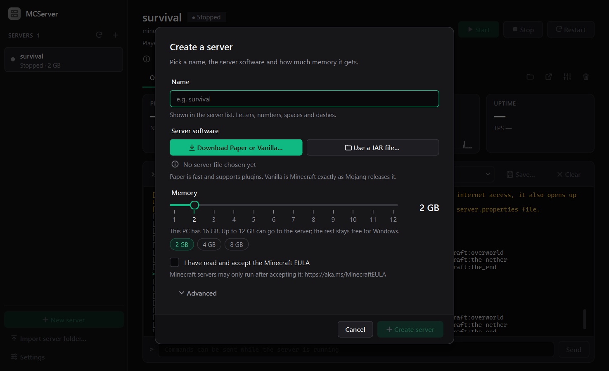
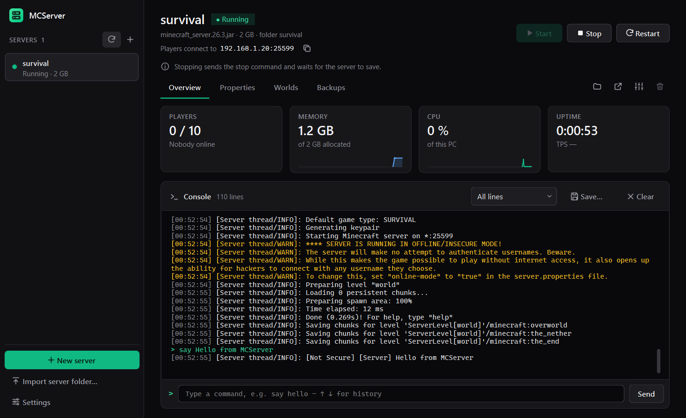
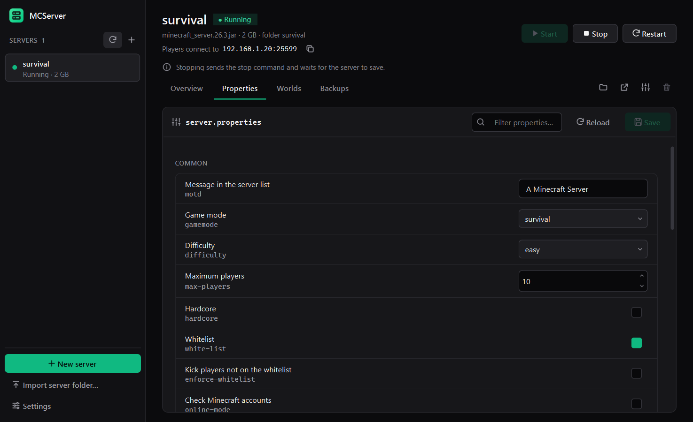
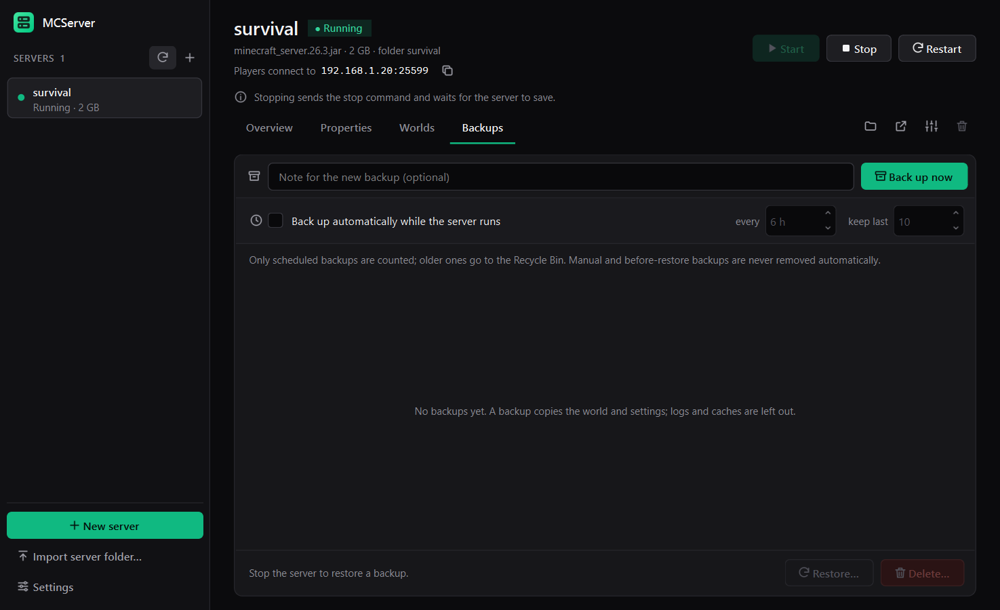

# MCServer user guide

MCServer runs Minecraft Java servers on your Windows PC. This guide covers everything in the app,
from installing it to fixing common problems.

**Contents:** [Install](#install) · [First launch](#first-launch) · [Java](#java) ·
[Create a server](#create-a-server) · [Import a server](#import-an-existing-server) ·
[Start, stop, restart](#start-stop-and-restart) · [Console](#console) ·
[Server settings](#server-settings) · [Worlds](#worlds) · [Backups](#backups) ·
[App settings](#app-settings) · [Where files are](#where-your-files-are) ·
[Troubleshooting](#troubleshooting)

## Install

1. Download `MCServer-<version>-setup.exe` from
   [Releases](https://github.com/theloomik/MCServer/releases).
2. Run it. MCServer installs for your Windows account, so no administrator rights are needed.
   ("Install for all users" is also offered; that one asks for administrator rights.)
3. Open **MCServer** from the Start menu.

Windows may show "Windows protected your PC" the first time, because the installer is not
code-signed yet. Choose **More info → Run anyway**.

**Updating:** run the newer installer; your servers stay as they are.
**Uninstalling:** Windows Settings → Apps → MCServer → Uninstall. Your servers, worlds and
backups are kept (see [Where your files are](#where-your-files-are)).

## First launch

A short setup guide opens on the first start:

1. **Java** — shows whether Java was found (see [Java](#java)).
2. **Servers folder** — where MCServer keeps your servers.
3. **Your first server** — create a new one or import one you already have.

You can skip it and open it again any time from **Settings → Help → Setup guide**.

## Java

Minecraft servers run on Java. MCServer does not include Java; it finds the Java installed on
your PC by itself.

- Minecraft **1.20.5 and newer need Java 21** or newer. Older versions run on older Java.
- No Java yet? Install a Java runtime such as [Eclipse Temurin](https://adoptium.net), then press
  **Check again** in **Settings → Java**.
- To use a specific Java, press **Choose java.exe…**. **Detect automatically** goes back to
  automatic detection.
- One server can use its own Java: **Edit… → Java for this server**.

If a server needs a newer Java than the one found, MCServer tells you before starting it.

## Create a server

Press **New server** (or Ctrl+N).

1. **Name** — shown in the server list.
2. **Server software** — either:
   - **Download Paper or Vanilla…** — pick the type and Minecraft version. Paper is faster and
     runs plugins; Vanilla is the unmodified game. Files come only from PaperMC and Mojang and are
     checked against their published checksums. **Show test versions** lists snapshots and
     pre-releases.
   - **Use a JAR file…** — a server JAR you already have. Only run JAR files from sources you trust.
3. **Memory** — how much RAM the server gets, in whole gigabytes. The slider only goes as high as
   your PC can spare; the rest stays free for Windows. 2 GB is plenty for a few friends.
4. **I accept the Minecraft EULA** — required by Mojang to run a server
   ([read it](https://aka.ms/MinecraftEULA)).
5. **Advanced** (optional) — the folder name, if you want it different from the name.

Press **Create server**. MCServer creates the folder and copies the JAR; then press **Start**.

## Import an existing server

Already have a server folder? Press **Import server folder…**, choose the folder, then pick its
server JAR, a name and the memory.

- A folder **outside** MCServer's servers folder is **copied** in; the original is not changed.
- A folder already **inside** the servers folder is used where it is.

**Coming from MCServer 0.9.1?** Your servers are still in `%LOCALAPPDATA%\MCServer\servers`, but
MCServer 2.0 doesn't list them until you import them: use **Import server folder…** for each one.
Nothing in them is moved or changed.

## Start, stop and restart

Select a server in the list on the left. The buttons at the top right:

- **Start** (Ctrl+R) — the status changes to *Starting*, then *Running* once players can join.
- **Stop** — sends the `stop` command and waits for the server to save the world.
- **Restart** — stops and starts again.
- **Kill** appears only if a server does not stop in time. It ends the server immediately, so
  changes since its last autosave can be lost. Use it only when Stop doesn't work.

MCServer runs **one server at a time**. If you close MCServer while a server is running, it asks
to stop the server first, so the world is saved.

**Players connect to** shows the address for players on your network; **Copy** puts it on the
clipboard. Friends outside your home network need port forwarding on your router (MCServer does
not set that up).

The cards show players online, memory used, CPU use and uptime. The small charts show the last
minutes of memory and CPU.

The icons next to the tabs open the server folder, open its logs, **Edit…** the server (name,
memory, JAR, extra Java arguments, Java) and **Delete…** it. Deleting removes the server from
MCServer; its folder stays where it is unless you tick **Also move its folder to the Recycle Bin**.

## Console

The console on the **Overview** tab shows the server's output live.

- Type a command (without `/`) and press Enter or **Send**, for example `say hello` or
  `op YourName`. ↑ and ↓ go through earlier commands. Ctrl+K jumps to the command line.
- **All lines / Warnings and errors** filters the output.
- **Save…** saves the output to a file; **Clear** empties the view (not the server's log files).

## Server settings

The **Properties** tab edits the server's `server.properties`: game mode, difficulty, players,
port, world options and more, with readable names. Type in the search box to find a setting by
its name or its technical key. Rare settings are under **Show more**.

Press **Save**. Changes apply the next time the server starts; MCServer reminds you to restart
a running server. Values that are not valid are marked and nothing is saved until you fix them.

## Worlds

The **Worlds** tab lists the server's worlds. Stop the server to change them.

- **New world…** — a name and, optionally, a seed. It is generated on the next start.
- **Import folder…** / **Import ZIP…** — a world folder (with `level.dat`) or a ZIP of one.
- **Use this world** — the server loads it on the next start.
- **Export ZIP…** — save a world as a ZIP file, for example to share it.
- **Delete…** — moves the world (with its Nether and End) to the Recycle Bin.

## Backups

The **Backups** tab keeps copies of the server: the world and settings, without logs and caches.

- **Back up now** — works while the server runs too. Add a note if you like.
- **Back up automatically while the server runs** — every few hours, keeping the last few. Only
  these scheduled backups are cleaned up; older ones go to the Recycle Bin. Manual backups are
  never removed automatically.
- **Restore…** — stop the server first. Before restoring, MCServer saves the current state as a
  *Before restore* backup, so a restore can be undone.
- **Delete…** — moves a backup to the Recycle Bin.

If MCServer or Windows was closed while a server was running, MCServer tells you on the next start
and offers to open the backups.

## App settings

Open **Settings** at the bottom left (Ctrl+,).

- **Appearance** — theme (Automatic follows Windows, Dark, Light) and language (English,
  Українська, or the Windows language).
- **Java** — which Java MCServer uses (see [Java](#java)).
- **Servers** — open the servers folder; **Stop timeout** (how long Stop waits before Kill is
  offered); **Startup timeout** (how long a start may take); **Restart a server automatically
  after a crash** (at most 3 times in 10 minutes; a server you stopped yourself is never restarted).
- **Help** — the setup guide and **About MCServer** (version and project page).

Keyboard shortcuts: Ctrl+N new server · Ctrl+R start · Ctrl+, settings · F5 refresh the list ·
Ctrl+1…4 tabs · Ctrl+L server list · Ctrl+K console.

## Where your files are

Everything you create lives in your user profile, never in the program folder:

| What | Where |
|------|-------|
| Servers (each in its own folder, with its worlds) | `%LOCALAPPDATA%\MCServer\servers\<server folder>` |
| MCServer's settings and server list | `%LOCALAPPDATA%\MCServer\servers\` |
| Backups | `%LOCALAPPDATA%\MCServer\servers\.backups\<server>` |

**Settings → Servers folder → Open** opens it. Paste `%LOCALAPPDATA%\MCServer` into the Explorer
address bar to get there directly. Updating or uninstalling MCServer never touches this folder.
MCServer never deletes server files permanently: deleted servers, worlds and backups go to the
Recycle Bin.

## Troubleshooting

**"Java was not found"** — install Java 21 or newer (for example
[Eclipse Temurin](https://adoptium.net)), then **Settings → Java → Check again**. If Java is
installed somewhere unusual, use **Choose java.exe…**.

**"This server needs a newer Java version"** — the Minecraft version needs a newer Java than the
one MCServer uses. Install it, or pick it with **Choose java.exe…** (or per server in **Edit…**).

**"Another program is already using the server's port"** — another server or program uses the
port (25565 by default). Close it, or change **Server port** on the **Properties** tab.

**"The server ran out of memory"** — give it less memory in **Edit…** (yes, less: the PC may not
have that much free), or close other programs.

**"The server JAR looks damaged"** — download it again, or choose another JAR in **Edit…**.

**"The Minecraft EULA wasn't accepted"** — MCServer asks you to accept it on the next start.

**The server doesn't finish starting** — large modpacks may need longer: raise **Startup timeout**
in Settings. Check the console for errors.

**Stop takes a long time** — the server is saving. Wait; if it never finishes, **Kill** ends it
(unsaved changes since the last autosave are lost).

**Friends can't join** — check that they use the address shown under **Players connect to** and
that the server is *Running*. Over the internet, the port has to be forwarded on your router, and
Windows Firewall must allow Java (Windows asks the first time a server starts).

**Something else** — press **Details…** on an error to see the technical details and copy them,
then [report the problem](https://github.com/theloomik/MCServer/issues/new/choose).
